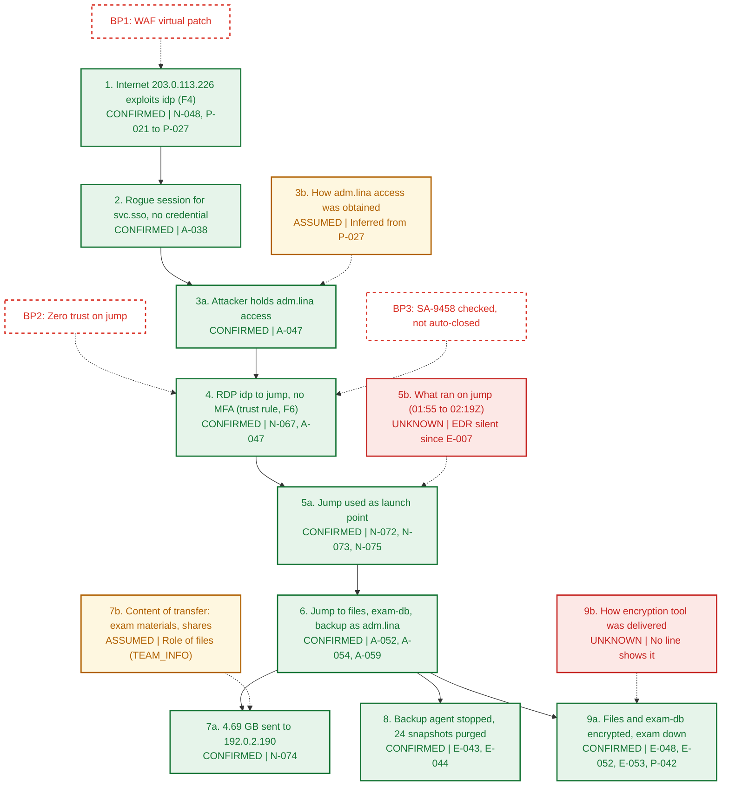

# Report: Case Study 3

**CNET 463 – Network Security Management: Exposure, Incident Response and Assurance (Team T01)**

## Team Members & Responsibilities
* **Abdullah Abdali:** Part A & B
* **Abdulaziz Mashnawi:** Part C
* **Abdulaziz Difallah Al-Makhlouti:** Part D
* **Khalid Alfaifi:** Part E

## Contents
1. [Part A & B – Exposure Prioritization, Attack Path and Detection](#part-a--b--exposure-prioritization-attack-path-and-detection)
2. [Part C – SOC Investigation and Incident Timeline](#part-c--soc-investigation-and-incident-timeline)
3. [Part D – Incident Response and Recovery Decision](#part-d--incident-response-and-recovery-decision)
4. [Part E – Assurance, Security Metrics and Executive Guidance](#part-e--assurance-security-metrics-and-executive-guidance)
5. [References](#references)

> **Evidence-pack note:** `TEAM_INFO.txt` documents the complete synthetic evidence pack used for this analysis. The source log files named there (`auth_idp.log`, `endpoint_edr.log`, `network_fw_dns.log`, and `app_audit.log`) are not included as separate repository files; their evidence IDs, timestamps, and conclusions are reproduced and cited in this report. The supporting files that are included in the repository remain available for direct inspection.

---

# Part A & B – Exposure Prioritization, Attack Path and Detection

**Assigned to:** Abdullah Abdali

## Part A – Exposure Prioritization

### A1. Prioritization table

| Finding | CVSS | KEV | EPSS | Reachability | Privilege | Business Impact | Existing Control | Priority |
| :--- | :--- | :--- | :--- | :--- | :--- | :--- | :--- | :--- |
| **F4** IDP | 5.5 | Y | 0.83 | Internet | None | High | Partial WAF rule; no virtual patch | 1 |
| **F6** JUMP | 8.2 | N | 0.29 | Admin zone + trusted server sources | Low | High | MFA for workstation logins only | 2 |
| **F5** BACKUP | 7.4 | N | 0.11 | Admin zone only | Admin | High | Retention lock; console shares admin credentials | 3 |
| **F8** EXAM-APP | 7.3 | N | 0.34 | Via PEP, authenticated users | User | High | PEP + WAF | 4 |
| **F2** FILES | 8.7 | Y | 0.49 | Internal (User + Admin zones) | None | Medium | Host EDR | 5 |
| **F1** WORKSTATIONS (300) | 8.6 | Y | 0.40 | User zone, needs user interaction | User | Medium | EDR; browser auto-update | 6 |
| **F7** PRINTERS (13) | 9.6 | N | 0.07 | Staff zone, internal only | None | Low | No sensitive data; VLAN ACL | 7 |
| **F3** LABSRV | 9.5 | N | 0.06 | Isolated, no route out | Local | Low | Zone isolated | 8 |

### A2. Reasons for the ranking

1. **F4:** Actively exploited (KEV=Y) with the highest EPSS in the set (0.83). Reachable from the Internet with no privilege. It is the SSO for all exam logins and exam tokens (High). Only a partial WAF rule and no virtual patch. It is also the entry point that leads to F6.
2. **F6:** The jump host is the gateway to all servers. It trusts server sources and enforces MFA only for workstation logins, so a compromised server can reach it without MFA. Low privilege required, High impact. Ranked below F4 because KEV=N and EPSS is lower (0.29).
3. **F5:** High impact, because the backup console shares admin credentials and a stolen admin account could destroy recovery capability. Likelihood is lower (KEV=N, EPSS 0.11, Admin zone and Admin privilege required).
4. **F8:** Affects the exam application itself (High). It is not known to be exploited (KEV=N, EPSS 0.34), needs an authenticated user, and sits behind PEP and WAF.
5. **F2:** Actively exploited (KEV=Y, EPSS 0.49) with no privilege required. Ranked below F8 because it is reachable only from internal zones, not the Internet. Host EDR reduces the risk but detects rather than prevents.
6. **F1:** Actively exploited (KEV=Y, EPSS 0.40), but needs user interaction. Mitigated by EDR, browser auto-update and user awareness. Medium impact.
7. **F7:** Highest CVSS in the set (9.6) and no privilege required, so any device in the staff zone can reach it. However KEV=N, EPSS 0.07, the printers hold no sensitive data, and a VLAN ACL limits access. Low impact.
8. **F3:** Very high CVSS (9.5), but the lab zone is isolated with no routes in or out, so it cannot be reached from other zones and any compromise stays contained. KEV=N, EPSS 0.06, Low impact.

### A3. Why no single signal is the final answer

CVSS measures how severe a vulnerability would be if exploited, but it does not consider whether anyone is exploiting it or whether attackers can reach it in our network. KEV shows active exploitation and EPSS estimates the probability of exploitation in the next 30 days [8][9][10], but neither considers our network position, existing controls or business impact.

The signals in our table point in opposite directions. F4 has the lowest CVSS in the set (5.5), yet it is ranked first: it is listed in KEV, has the highest EPSS (0.83), is reachable from the Internet with no privilege, and is the SSO for all exam logins. F3 has one of the highest CVSS scores (9.5) but is ranked last: KEV=N, EPSS 0.06, and the zone is isolated. A CVSS-only ranking would have fixed F3 (and F7) before F4, the reverse of the real risk. The incident confirms the ranking: F4 was the entry point (P-027, A-038) and F6 the path to the servers (A-047), while F3 and F7 played no part.

KEV alone is not enough: F1 and F2 are both KEV=Y, but F1 needs user interaction and F2 is reachable only from internal zones. EPSS alone is not enough either: F8 has a higher EPSS (0.34) than F6 (0.29), but F6 ranks higher because the jump host trusts server sources without MFA and is the path from a compromised server to all internal servers. Priority therefore combines likelihood (KEV, EPSS), exposure (reachability, privilege), impact (business criticality) and existing controls.

### A4. Top-two treatments and deadlines

All times are UTC. The advice is written for "now" (2026-12-14T04:05:30Z). The exam schedule (`exam_schedule.csv`) has D morning at 07:30Z (about 600 students), and the last session of the week ends at 2026-12-16T08:30Z. Because the incident has already happened (Parts C and D), the exam service is postponed to D+1 morning (2026-12-15T06:30Z); the immediate fixes below are therefore also conditions for restoring it.

#### F4 – idp (priority 1)
* **Immediate, now and no later than 07:30Z today:** Apply a virtual patch (WAF rule) that blocks requests to the vulnerable session-validation endpoint, block 203.0.113.226, and invalidate active sessions that did not present credentials. idp must stay online (restricted) because every exam login and token depends on it, so full isolation would stop the exam itself.
* **Before the exam service is restored (D+1 morning, 2026-12-15T06:30Z):** The idp is rebuilt from a clean image with the virtual patch in place (D4). The rebuild happens in the isolated recovery network, so it does not touch students.
* **Permanent, after the final session ends (2026-12-16T08:30Z):** Install the vendor patch after testing and then remove the temporary WAF rule. An untested vendor change during exam week could break SSO, and recovering from a failed change could take many hours while students wait to log in.

#### F6 – jump (priority 2)
* **Immediate, now and no later than 07:30Z today:** Remove the trust rules that let server sources log in without MFA (`service_trust_rule`, `admin_trust_rule`), block DMZ servers from opening RDP to the Admin zone, and require MFA for every privileged login whatever the source. Students do not use the jump host, so this does not affect the exam.
* **Permanent, after 2026-12-16T08:30Z:** Apply the vendor patch for the privilege-escalation flaw. The jump host itself is rebuilt before then (Part D) because it is compromised.

---

## Part B – Attack Path and Detection

All times are UTC. Lines from `endpoint_edr.log` (+03:00) were converted by subtracting 3 hours.

### B1 and B2. Attack path with evidence status

| Step | What Happened | Status | Evidence |
| :--- | :--- | :--- | :--- |
| **1** | Attacker probes and then exploits the session-validation flaw (F4) on the Internet-facing idp (the hostile requests are Confirmed; that P-027 is the exploitation itself is inferred, no payload is logged) | Confirmed | N-048, P-021 to P-027 |
| **2** | Session created for service account svc.sso with no credential | Confirmed | A-038 |
| **3A** | Attacker holds valid adm.lina access | Confirmed | A-047 |
| **3B** | How it was obtained: possibly harvested from the idp | Assumed | Inferred from P-027 (larger-than-normal response); no line shows the theft |
| **4** | RDP from idp to jump; adm.lina logs in without MFA via the service trust rule (F6 weakness) | Confirmed | N-067, A-047 |
| **5A** | Jump host used as the launch point to the servers | Confirmed | N-072, N-073, N-075 (all from 10.170.40.20) |
| **5B** | What the attacker did on the jump host (01:55 to 02:19Z) | Unknown | Jump EDR not reporting since E-007 (20:52:00Z) |
| **6** | Lateral movement to files, exam-db and backup as adm.lina | Confirmed | N-072 + A-052, N-073 + A-054, N-075 + A-059 |
| **7A** | 4.69 GB sent from the file server to an external address | Confirmed | N-074 |
| **7B** | Content: likely exam materials and staff shares | Assumed | Inferred from the file server's role in TEAM_INFO.txt |
| **8** | Backup agent stopped and 24 snapshots purged | Confirmed | E-043 (03:01:24Z), E-044 (03:01:42Z); backup_report.txt: repository reachable with the admin console account |
| **9A** | Exam materials and exam-db encrypted; ransom note; exam service down | Confirmed | E-048 (03:26:28Z), E-052, E-053 (03:28:55Z), P-042 |
| **9B** | How the encryption tool was delivered | Unknown | No line shows the tool or its source |

**Critical asset reached:** The Online Examination System (exam materials, exam database and the backups needed to restore them).

**Note on F2 and F5:** The attacker entered the file server with valid adm.lina credentials (A-052), so there is no evidence that the F2 authentication bypass was used. The F5 weakness is supported by evidence: `backup_report.txt` says the repository is "reachable with the administrator console account (same credential family as jump/files)", and E-043 and E-044 were run as adm.lina, which is consistent with the admin login in A-059. What is not shown is how the console credential itself was accepted (no backup-console log).

### B3. Breakpoints

1. **Step 1 (Internet to idp), preventive:** A virtual patch on the WAF in front of idp that blocks requests to the vulnerable session-validation endpoint. A WAF already exists (F4: "Partial WAF rule"), so extending it would likely have stopped the exploitation before any session was created.
2. **Step 4 (idp to jump), preventive:** Zero trust on the jump host: remove the service trust rule, block DMZ servers from opening RDP to the Admin zone, and require MFA for every privileged login. This would have blocked the path used here (N-067, A-047), so the attacker could not have used jump as a launch point.
3. **After step 4, detective:** SOC alert SA-9458 (P-033, 01:59:19Z) was auto-closed as maintenance. Checked against the change calendar, it would have shown that no window was open and that adm.lina has none. That is about 20 minutes before the pivots to the servers (02:19:46Z) and 30 minutes before the exfiltration (02:29:31Z).

### B4. Missing telemetry for unconfirmed steps

| Step | Status | Missing Telemetry | What It Would Show |
| :--- | :--- | :--- | :--- |
| **3B HOW ADM.LINA CREDENTIALS WERE OBTAINED** | Assumed | Detailed idp application logs and WAF logs with request and response content | What the oversized response in P-027 returned, and whether it held adm.lina credential material |
| **5B ACTIVITY ON THE JUMP HOST** | Unknown | EDR telemetry on jump (not reporting since E-007), RDP session recording, Windows security logs | Processes, commands and tools run between 01:55 and 02:19Z |
| **7B CONTENT OF THE 4.69 GB TRANSFER** | Assumed | File access audit logs on files, plus outbound content inspection (proxy or DLP) | Which files adm.lina opened between 02:19 and 02:29Z, and what left the network |
| **9B DELIVERY OF THE ENCRYPTION TOOL** | Unknown | Full EDR process-execution logs on files and exam-db, plus SMB file-transfer logs | The name and source of the encryption program, and which account launched it |

### B5. MITRE ATT&CK mapping [11]

| Behaviour (Step) | Tactic | Technique | Evidence |
| :--- | :--- | :--- | :--- |
| **Exploitation of the Internet-facing idp (Step 1)** | Initial Access | T1190 Exploit Public-Facing Application | P-027 (successful oversized response after failed attempts P-021 to P-026), A-038 |
| **RDP from idp to the jump host (Step 4)** | Lateral Movement | T1021.001 Remote Services: Remote Desktop Protocol | N-067 (10.170.10.10 to 10.170.40.20:3389), A-047 |
| **Backup agent stopped and 24 snapshots purged (Step 8)** | Impact | T1490 Inhibit System Recovery | E-044 (snapshot-purge --all, snapshots_removed=24), E-043 |
| **Exam materials and exam-db encrypted (Step 9A)** | Impact | T1486 Data Encrypted for Impact | E-048, E-053 (new_ext=.t01lck), E-052 (ransom note) |

### B6. Attack-path diagram

---

# Part C – SOC Investigation and Multi-Source Incident Timeline

**Assigned to:** Abdulaziz Mashnawi

## C.1 Multi-Source Chronological Incident Timeline

All timestamps are normalised to Coordinated Universal Time (UTC). The endpoint log (`endpoint_edr.log`) records Arabian Standard Time (UTC+03:00), so 3 hours were subtracted (for example 06:01:24+03:00 becomes 03:01:24Z). The timeline combines four sources: identity (A-), endpoint (E-), network/firewall (N-) and application/SOC audit (P-), plus `change_calendar.csv`.

| Time (UTC) | Source Host / IP | Evidence ID | Event and Telemetry Evidence | Lifecycle Stage |
| :--- | :--- | :--- | :--- | :--- |
| **2026-12-13 20:15:00Z** | `jump.t01.uni.lab` | `P-001` | Change window opens (CHG-9865): approved pre-exam health check for adm.rakan on jump, 20:15:00Z to 22:00:00Z (`change_calendar.csv`). | Authorized maintenance |
| **2026-12-13 20:52:00Z** (23:52:00+03:00) | `jump.t01.uni.lab` | `E-007` | EDR telemetry blackout on jump: agent status becomes not_reporting (reason=service_unreachable). It happens inside CHG-9865 but 6 min before adm.rakan logs in; the cause is Unknown. No further EDR record exists for jump in the pack. | Telemetry impairment |
| **2026-12-13 20:58:00Z** | `jump.t01.uni.lab` 10.170.40.50 | `A-008` | Legitimate admin session: adm.rakan logs in from the admin workstation with push MFA (mfa=push_ok, path=admin_workstation) inside CHG-9865. | Authorized activity |
| **2026-12-14 01:13:01Z** | `idp.t01.uni.lab` 203.0.113.226 | `N-048` `P-021` | External ingress and first probe: Internet IP 203.0.113.226 connects to idp HTTPS 443 (bytes=2050); POST /oauth/introspect returns HTTP 500 (ua="http-lib/4.1"). | Initial access / probing |
| **2026-12-14 01:13:34Z to 01:14:43Z** | `idp-web` 203.0.113.226 | `P-022` `P-023` `P-024` `P-026` | Fuzzing of Finding F4: POST /oauth/token (500), /oauth/introspect (400), /api/session (400), /oauth/introspect (500), same client http-lib/4.1. | Exploit probing |
| **2026-12-14 01:15:15Z** | `idp-web` 203.0.113.226 | `P-027` | Exploitation of F4: POST /oauth/introspect returns HTTP 200 with bytes=15198 (note=response_larger_than_normal). F4 = SYN-2026-7537, KEV=Y, EPSS 0.83 (`findings.csv`). | Exploitation |
| **2026-12-14 01:17:31Z** | `idp.t01.uni.lab` 203.0.113.226 | `A-038` | Rogue session: SESSION_CREATE for svc.sso from 203.0.113.226 with method=none, mfa=not_applicable, note=no_credential_presented. | Credential access / persistence |
| **2026-12-14 01:28:00Z to 01:28:33Z** | `soc-scan` 10.170.40.5 | `N-052` to `N-063` | Authorized SOC vulnerability scan: 12 short connections, 3 s apart, to ports 22, 80, 135, 443, 445 and 5432 on servers in the DMZ and Servers zones. `TEAM_INFO.txt` authorises soc-scan. | Benign operational noise |
| **2026-12-14 01:55:45Z to 01:55:47Z** | idp to jump 10.170.10.10 | `N-067` `A-047` | Lateral movement to the Admin zone (Finding F6): RDP (3389) from the DMZ idp to jump (N-067), then LOGIN_OK as adm.lina with mfa=not_required, path=service_trust_rule (A-047). | Lateral movement / privilege escalation |
| **2026-12-14 01:59:19Z** | soc (host jump) | `P-033` | SOC alert SA-9458 (rule priv-login-from-server-source, user adm.lina) is AUTO_CLOSED by the SOAR playbook (reason=matches_known_maintenance_pattern). No change window was open at that time. | Detection failure |
| **2026-12-14 02:19:46Z to 02:19:48Z** | jump to files 10.170.40.20 | `N-072` `A-052` | Pivot to the file server: SMB (445) from jump to files, then LOGIN_OK as adm.lina, mfa=not_required, path=admin_trust_rule. | Lateral movement |
| **2026-12-14 02:24:29Z to 02:24:31Z** | jump to exam-db 10.170.40.20 | `N-073` `A-054` | Pivot to the exam database: PostgreSQL (5432) from jump to exam-db, then LOGIN_OK as adm.lina, mfa=not_required, path=admin_trust_rule. | Lateral movement |
| **2026-12-14 02:29:31Z** | files to external 192.0.2.190 | `N-074` | Mass exfiltration: 4,688,452,260 bytes (about 4.69 GB) over HTTPS (443) from files (10.170.30.15) to 192.0.2.190 (note=egress_from_Servers). | Exfiltration (double extortion) |
| **2026-12-14 02:31:04Z to 02:31:06Z** | jump to backup 10.170.40.20 | `N-075` `A-059` | Access to the backup server (consistent with Finding F5): SSH (22) from jump to backup, then LOGIN_OK as adm.lina, mfa=not_required, path=admin_trust_rule. `backup_report.txt` confirms the repository is reachable with the admin console account. | Lateral movement |
| **2026-12-14 02:41:29Z** (Window to 04:11:29Z) | `jump.t01.uni.lab` | `P-037` | Change window opens (CHG-5871): approved jump-host maintenance for adm.rakan, 02:41:29Z to 04:11:29Z (`change_calendar.csv`). The window is still open at "now". | Authorized maintenance |
| **2026-12-14 02:56:29Z** | `jump.t01.uni.lab` 10.170.40.50 | `A-062` | Legitimate admin session: adm.rakan logs in from the admin workstation with push MFA inside CHG-5871. It lands on a host that adm.lina had already used. | Authorized activity |
| **2026-12-14 03:01:24Z to 03:01:42Z** (06:01:24+03:00) | `backup.t01.uni.lab` 10.170.30.30 | `E-043` `E-044` | Sabotage of recovery assets: backup-agent service stopped (E-043); "snapshot-purge --all" run as adm.lina, result=ok, snapshots_removed=24 (E-044). | Inhibit system recovery |
| **2026-12-14 03:26:28Z to 03:27:45Z** (06:26:28+03:00) | `files.t01.uni.lab` 10.170.30.15 | `E-048` `E-049` `E-051` | Mass encryption of the exam-materials share: renames to .t01lck: 1,585 + 11,477 + 57,638 = 70,700 files (assuming each burst counts a separate batch; if the counts are cumulative, the total is 57,638). | Impact (ransomware) |
| **2026-12-14 03:27:30Z** (06:27:30+03:00) | `files.t01.uni.lab` | `E-050` | EDR alert CS-207 (critical, "mass file modification") with action=detected_only: no containment. | Failed containment |
| **2026-12-14 03:28:01Z** | `files.t01.uni.lab` | `E-052` | Ransom note dropped: `\\files\shares\exam-materials\README_RESTORE.txt` created. | Impact |
| **2026-12-14 03:28:55Z** (06:28:55+03:00) | `exam-db.t01.uni.lab` 10.170.30.10 | `E-053` | Database encryption: 395 files renamed to .t01lck on volume db-data. | Impact |
| **2026-12-14 03:39:54Z** | `exam-app.t01.uni.lab` | `P-042` | Service outage: exam-app reports storage_unavailable on /mnt/files/exam-materials; requests_failed=69. | Operational denial of service |
| **2026-12-14 03:53:30Z** | soc | `P-043` | Incident IR-911 declared (severity=critical, by soc.lead). Scope listed: files, jump, backup (note=ransomware_like_activity). | Incident declaration |
| **2026-12-14 04:05:30Z** | soc | `P-044` | "Now": the security manager requests advice (management_requests_advice_at_this_time). | Decision point |

---

## C.2 Epistemic Analysis: Confirmed, Assumed and Unknown

| Domain | Status | Evidence and Deduction |
| :--- | :--- | :--- |
| **INITIAL ACCESS VECTOR** | CONFIRMED | Exploitation of Finding F4 (SYN-2026-7537, session-validation flaw on idp). Evidence: inbound connection from 203.0.113.226 (N-048); probe sequence returning 500 and 400 (P-021 to P-026); HTTP 200 with 15,198 bytes (P-027); unauthenticated session for svc.sso (A-038).  *Inference:* the events themselves are Confirmed; only the causal link between P-027 and A-038 is Assumed (the log shows no payload), as stated in Part B step 1. |
| **ELEVATION TO THE JUMP HOST** | CONFIRMED and ASSUMED | **Confirmed:** RDP from idp (10.170.10.10) to jump (N-067) and LOGIN_OK as adm.lina, mfa=not_required, path=service_trust_rule (A-047).  **Assumed (Part B, step 3b):** the attacker obtained adm.lina access on or through the idp host (for example cached or relayed credentials) or used the trust rule directly, because the RDP session came from idp itself. P-027 hints at data leakage but no log shows the theft, so the method is not confirmed. |
| **ACTIVITY INSIDE JUMP** | UNKNOWN | Processes, scripts and tools run on jump are unknown: its EDR stopped reporting at 20:52:00Z (E-007) and the pack contains no Windows event log (for example event IDs 4688, 4104). Needed: jump disk and memory images, or restored EDR data. |
| **CAUSE OF THE EDR BLACKOUT ON JUMP** | UNKNOWN | E-007 says only service_unreachable. It occurred during approved maintenance (CHG-9865), so maintenance, a fault or attacker action are all possible. It happened 4 h 21 min 01 s before the first probe (01:13:01Z) and 5 h 03 min 47 s before A-047, so a link to this attack is Assumed at most. |
| **LATERAL MOVEMENT TO CORE SERVERS** | CONFIRMED | From jump as adm.lina with MFA bypassed (admin_trust_rule): files over SMB at 02:19:46Z (N-072, A-052); exam-db over PostgreSQL at 02:24:29Z (N-073, A-054); backup over SSH at 02:31:04Z (N-075, A-059). |
| **DATA EXFILTRATION** | CONFIRMED and UNKNOWN | **Confirmed:** 4,688,452,260 bytes from files to 192.0.2.190 over 443 at 02:29:31Z (N-074).  **Assumed:** the data came from the exam-materials share, because the source host is files.  **Unknown:** the actual content (exam questions, grades, personal data). A layer-4 firewall log cannot show it; DLP or packet capture is needed. |
| **SABOTAGE OF BACKUPS** | CONFIRMED | backup-agent stopped (E-043, 03:01:24Z) and 24 snapshots purged (E-044, 03:01:42Z) as adm.lina. `backup_report.txt` confirms "snapshots listed at report time: 0 (purged)". |
| **RANSOMWARE EXECUTION AND IMPACT** | CONFIRMED | 70,700 files renamed to .t01lck on files (E-048, E-049, E-051); ransom note (E-052); 395 database files on exam-db (E-053); exam-app fails with storage_unavailable, 69 failed requests (P-042).  **Unknown:** the ransomware binary, how it was launched, and the account used. E-048 to E-053 show no user field. |
| **ATTRIBUTION AND REAL IDENTITY** | UNKNOWN | Who controls 203.0.113.226 and 192.0.2.190 is not in the pack (documentation-only ranges, no threat intelligence). Whether both addresses belong to one actor is Assumed from the timing, not proven. |

---

## C.3 Suspicious Activity Deconfliction and Detection Failure Analysis

### 1. Suspicious-looking activity explained by other evidence
* **Approved SOC vulnerability scan (N-052 to N-063):** Twelve connections, 3 seconds apart, between 01:28:00Z and 01:28:33Z touch ports 22, 80, 135, 443, 445 and 5432 on several servers, which resembles reconnaissance. All come from 10.170.40.5, and `TEAM_INFO.txt` states: "Approved vulnerability scanner: soc-scan (10.170.40.5). Scanning from it is authorised." Benign. It overlaps in time with the attack but not in source.
* **Administrator maintenance by adm.rakan (A-008, A-062):** Privileged logins to jump at 20:58:00Z and 02:56:29Z came from the admin workstation 10.170.40.50 with push MFA. P-001 and P-037 plus `change_calendar.csv` show windows CHG-9865 (20:15:00Z to 22:00:00Z) and CHG-5871 (02:41:29Z to 04:11:29Z) for adm.rakan on jump. Benign. Caution: A-062 landed on a host the attacker had already used, so adm.rakan's credentials are treated as possibly exposed (Part D).
* **Student authentication failures and blocked traffic:** AUTH_FAIL events A-003, A-021, A-030, A-034, A-035, A-045, A-051, A-064 and A-065 are bad_password or mfa_timeout from the Users subnet (10.170.50.0/24). Firewall DROP events N-009, N-012, N-020, N-037 and N-070 are Users-zone connections to Servers-zone ports 22, 3389 or 5432 stopped by default_deny. No later ACCEPT follows them, so they are Assumed to be misconfigured clients or noise and not part of the attack chain.
* **Open question that stays open:** The jump EDR blackout (E-007). It overlaps the approved window CHG-9865, which could explain it, but no evidence confirms that. It is reported as Unknown, not as benign and not as malicious.

### 2. Alerts raised and what happened to them
* **SA-9458 (P-033), auto-closed:** At 01:59:19Z the rule priv-login-from-server-source fired on adm.lina's login to jump from the DMZ server idp (10.170.10.10). The SOAR playbook set status=AUTO_CLOSED with reason=matches_known_maintenance_pattern. This was wrong on every point that can be checked: CHG-9865 ended at 22:00:00Z on 13 December, 3 h 59 min earlier; CHG-5871 only opened at 02:41:29Z, 42 min 10 s later; and both windows are for adm.rakan from 10.170.40.50, not for adm.lina from a DMZ server. The only high-fidelity alert before the data theft was therefore suppressed, and the attacker moved freely: 30 min 12 s until the data theft (02:29:31Z), 1 h 02 min 23 s until the backup purge (03:01:42Z) and 1 h 27 min 09 s until the encryption started (03:26:28Z).
* **CS-207 (E-050), detected but not stopped:** At 03:27:30Z the files EDR raised a critical alert for mass file modification, but the policy was action=detected_only. No process was killed and no host was isolated, so the encryption bursts (E-048 to E-051) ran for 77 seconds to 03:27:45Z and then reached exam-db (E-053, 03:28:55Z). The detection existed, the response did not.
* **Blind spots:** jump had no EDR data after 20:52:00Z (E-007), and no alert fired on the 4.69 GB egress (N-074) or on the backup purge (E-044). Detection depended on one rule that was closed automatically.
* **EDR "clean" scans do not clear idp:** SCAN_COMPLETE result=clean was recorded on idp at 21:37:15Z (E-013), 23:47:54Z (E-024) and 03:53:16Z (E-054), converted from +03:00. The last one comes after the F4 exploitation (P-027, A-038) and the RDP pivot (N-067), so it does not contradict the compromise: F4 is a session-validation flaw abused without malware, and a file-based EDR scan has nothing to find. The clean scan of files at 01:23:46Z (E-035) is before the attacker reached it (A-052, 02:19:48Z). The scan results are Confirmed; the explanation is Assumed.

---

## C.4 Attack Milestones and Exposure Duration

| Milestone | Timestamp (UTC) | Evidence and Basis | Elapsed Time |
| :--- | :--- | :--- | :--- |
| **1. ATTACK INCEPTION (FIRST PROBE)** | 2026-12-14 01:13:01Z | First hostile request on idp from 203.0.113.226 (N-048, P-021). | T + 0 (baseline) |
| **2. FOOTHOLD** | 2026-12-14 01:17:31Z | Rogue svc.sso session, no credential (A-038). | 4 min 30 s after first probe |
| **3. FIRST SOC VISIBILITY (SUPPRESSED)** | 2026-12-14 01:59:19Z | SA-9458 raised on the adm.lina login to jump, then auto-closed (P-033). | 46 min 18 s after first probe |
| **4. FIRST IMPACT: DATA (CONFIDENTIALITY)** | 2026-12-14 02:29:31Z | 4.69 GB leaves files for 192.0.2.190 (N-074). | 1 h 16 min 30 s after first probe |
| **5. FIRST IMPACT: RECOVERY CAPABILITY** | 2026-12-14 03:01:42Z | All 24 backup snapshots purged (E-044). | 1 h 48 min 41 s after first probe |
| **6. FIRST IMPACT: AVAILABILITY (ENCRYPTION STARTS)** | 2026-12-14 03:26:28Z | First .t01lck rename burst on files (E-048). | 2 h 13 min 27 s after first probe |
| **7. FIRST ENDPOINT DETECTION (PASSIVE)** | 2026-12-14 03:27:30Z | EDR rule CS-207 fires on files, detected_only (E-050). | 2 h 14 min 29 s after first probe |
| **8. SERVICE OUTAGE VISIBLE TO USERS** | 2026-12-14 03:39:54Z | exam-app storage_unavailable, 69 failed requests (P-042). | 2 h 26 min 53 s after first probe |
| **9. INCIDENT DECLARED** | 2026-12-14 03:53:30Z | IR-911, critical (P-043). | 2 h 40 min 29 s (160.5 min) after first probe |
| **10. DECISION POINT ("NOW")** | 2026-12-14 04:05:30Z | Security manager asks for advice (P-044). | 2 h 52 min 29 s after first probe |

**Summary:** The attack started at 01:13:01Z (first probe) and the foothold was gained at 01:17:31Z. It first became visible to the SOC at 01:59:19Z, but that alert was suppressed. It first had impact at 02:29:31Z (data theft), and availability impact began at 03:26:28Z. The university was exposed for **2 h 40 min 29 s (160.5 min)** from the first probe to the declaration of IR-911 at 03:53:30Z. Counted from the first alert (P-033) to the declaration, the delay was 1 h 54 min 11 s. Counted from the data theft (N-074), it was 1 h 23 min 59 s. At "now" (04:05:30Z) the exposure had lasted 2 h 52 min 29 s.

**Note on the start time:** 01:13:01Z is the first evidence of hostile activity. Earlier attacker presence cannot be excluded because the logs start at 2026-12-13T20:02:32Z and jump has no EDR data after 20:52:00Z. That is Unknown.

---

# Part D – Incident Response and Recovery Decision

**Assigned to:** Abdulaziz Difallah Al-Makhlouti

## Conventions
All times are UTC (Z). `endpoint_edr.log` records +03:00, so its times were converted by subtracting 3 hours. "Now" = 2026-12-14T04:05:30Z (`TEAM_INFO.txt`, P-044). Each conclusion is labelled **Confirmed** (direct evidence), **Assumed** (inferred, source stated) or **Unknown** (no evidence in the pack).

## Incident-response playbook (IR-911)
IR-911 is handled as a Critical ransomware incident with data theft, following the NIST incident life cycle [1][2] and ISO/IEC 27035 [5]: contain now, preserve evidence, get an exam decision from the Exam office, and rebuild in a clean, isolated network.

### 1. Detection / trigger
The playbook starts when any of these fires. Each one fired in this incident:
* EDR mass-file-modification alert: E-050 (03:27:30Z, rule CS-207, action=detected_only).
* Privileged login from a server source or without MFA, outside an approved change window: A-047 (01:55:47Z), P-033 (01:59:19Z).
* Backup agent stopped or snapshots deleted: E-043 and E-044 (03:01Z).
* Large Internet egress from the Servers zone: N-074 (02:29:31Z).
* Failure of a service the exam system depends on: P-042 (03:39:54Z).

The first trigger (P-033) came 1 h 54 min 11 s before the incident was declared (P-043), but it was auto-closed as "known maintenance".

### 2. Validation and scope
* **Malicious, not maintenance (Confirmed):** adm.lina has no approved change window; both windows (CHG-9865, CHG-5871) belong to adm.rakan (`change_calendar.csv`).
* **Legitimate activity excluded:** adm.rakan logins inside windows with MFA (A-008, A-062); approved scanner soc-scan at 01:28Z (N-052 to N-063, `TEAM_INFO.txt`).
* **Affected hosts (Confirmed):** files (E-048 to E-052), exam-db (A-054, E-053), backup (A-059, E-043, E-044), jump (A-047) and idp as the entry point (P-021 to P-027, A-038). Attacker control of the idp host itself is Assumed, from the RDP connection that started there (N-067).
* **Scope correction:** IR-911 lists only files, jump and backup (P-043). idp and exam-db must be added.
* **Accounts:** adm.lina and svc.sso misused (Confirmed). adm.rakan Assumed exposed (logged on to the compromised jump, A-062). Backup console credentials Assumed exposed ("same credential family as jump/files", `backup_report.txt`).
* **Assumed:** adm.lina access was obtained on or through the idp host (Part B, step 3b); the method is not shown in any log. **Unknown:** what ran on jump (EDR silent since E-007).

### 3. Severity
Critical (highest), using the NIST SP 800-61 Rev. 2 impact categories [1]:
* **Functional impact – High:** The exam service is unavailable (P-042) and the next session starts at 07:30Z for about 600 students (`exam_schedule.csv`).
* **Information impact – Breach (Assumed):** About 4.69 GB left the Servers zone from files (N-074); content Unknown.
* **Recoverability – not recoverable in time:** Snapshots purged (E-044) and the only restore test failed (`backup_report.txt`).

### 4. Containment
Immediate, targeted isolation of files, exam-db, backup and jump; idp restricted, not cut; adm.lina and svc.sso disabled; 203.0.113.226 and 192.0.2.190 blocked; trust rules removed; Servers-zone Internet egress denied. Full actions and justification are in D1. In addition, change window CHG-5871 on jump is still open at "now" (it ends 04:11:29Z) and must be cancelled, and all changes frozen (P-037, A-062).

### 5. Evidence preservation
* **Order of volatility (RFC 3227) [4]:** Keep isolated hosts powered on; capture memory first, then disk images; hash each image with SHA-256.
* **jump first:** Its EDR stopped reporting at 2026-12-13T20:52Z (E-007), so the host itself is the only evidence of what ran on it.
* Export and hash the four logs, `backup_report.txt`, `change_calendar.csv` and the SOC records SA-9458 and IR-911.
* Keep the ransom note `README_RESTORE.txt` (E-052) and sample .t01lck files.
* tape-04 stays offline and write-protected: it is evidence and the only recovery copy.
* A chain-of-custody record for every item: who, what, when (UTC), hash. No host is rebuilt before its image is taken.

### 6. Communication / escalation
Out-of-band channels only (phone, a clean messaging group), because administrator credentials are compromised. No contact with the attacker and no payment without a leadership and legal decision [6].

| Who | Message | By (UTC, 2026-12-14) |
| :--- | :--- | :--- |
| **Security Manager to University Leadership** | Critical incident; decision needed on exam sessions | Now (04:05Z) |
| **Exam Office (Owner of exam-app)** | Recommend postponing D morning and D midday to D+1; exam materials may be leaked | Decision now; latest 06:30Z |
| **Students: About 600 (D morning) and about 550 (D midday)** | Both sessions postponed; new time to follow | Before 07:30Z |
| **Identity team, Database owner, Infrastructure, Network team** | Containment and recovery tasks for their assets (`recovery_dependencies.csv`) | Now |
| **Change Board** | Cancel CHG-5871; freeze all changes | Now |
| **Legal / Data-Protection Officer** | Assess notification duty for the 4.69 GB exfiltration; handling of the ransom note | Today |

### 7. Eradication
* Rebuild files, exam-db, backup, jump and idp from known-good images; encrypted hosts are not cleaned in place.
* Close the exposures used: patch or virtually patch F4 on idp; remove `service_trust_rule` and `admin_trust_rule` and enforce MFA on every admin path (F6; A-047, A-052, A-054, A-059); patch F2 on files (KEV-listed); deny DMZ-to-Admin RDP (N-067); default-deny Internet egress from the Servers zone (N-074).
* Reset adm.lina, adm.rakan, svc.sso and the backup console credentials; revoke all idp sessions and tokens (tokens are still being issued at 04:02:09Z, A-072).
* **Backups:** A separate backup-admin identity with MFA (F5); immutable retention that admin credentials cannot purge (the configured retention lock did not stop E-044); vault key moved off `\\files\ops\vault\` to offline escrow.
* **Detection:** Fix the auto-close rule (P-033); restore jump EDR (E-007); set rule CS-207 to block, not detect only (E-050).
* Threat hunt on all hosts, including adm-ws, for persistence and for contact with 203.0.113.226 and 192.0.2.190.

### 8. Recovery
Restore from tape-04 into an isolated recovery network in dependency order (DNS, then idp, then exam-db and files, then exam-app), and reconnect only after the checks in D4. Timing against the exam schedule is in D3.

### 9. Closure and lessons learned
IR-911 closes only when every affected host is rebuilt and validated, all credentials are reset, one full exam session has run cleanly, and 14 days of monitoring show no indicator activity. A lessons-learned review follows within two weeks, each action with an owner:
* A KEV-listed flaw on the Internet-facing idp had no virtual patch (F4).
* Trust rules let admin logins skip MFA (A-047, A-052, A-054, A-059).
* A privileged-login alert was auto-closed without checking the change calendar (P-033).
* Backups reported SUCCESS but could be purged with admin credentials and had never been restored successfully (E-044, `backup_report.txt`).
* The vault key was stored on the server it protects.
* jump EDR was silent for 5 h 03 min 47 s before the attacker used jump, with no action (E-007 to A-047).
* The Servers zone allowed 4.69 GB of Internet egress (N-074).

---

## D1 – Immediate isolation vs continued observation

### 1. Trade-off

| Aspect | Immediate Isolation | Continued Observation |
| :--- | :--- | :--- |
| **Gains** | Stops further spread and data theft | Reveals the attacker's tools and full scope |
| **Costs** | Attacker may notice; some intelligence is lost | Damage grows every minute |
| **Suitable When** | Impact has started or is imminent | The attacker is in early stages with no impact yet |

### 2. Recommendation: immediate, targeted isolation

| Component | Status (Evidence) | Action |
| :--- | :--- | :--- |
| **files, exam-db, backup, jump** | Attacker activity Confirmed (E-048, E-053, E-044, A-047) | Isolate from the network; keep powered on to preserve memory evidence |
| **idp** | Entry point Confirmed (A-038) | Restrict, do not cut: block 203.0.113.226, apply a virtual patch for F4, revoke sessions and tokens. All logins and exam tokens depend on it (`recovery_dependencies.csv`). The clean rebuilt idp (D4, step 2) replaces it at cutover. |
| **exam-app** | No evidence of compromise (heartbeats E-056); Assumed clean | Disconnect from files and exam-db; show a maintenance page |
| **Servers and DMZ Egress** | 4.69 GB left to 192.0.2.190 (N-074) | Deny Internet egress from the Servers zone; allow DMZ egress only for idp to approved destinations; block 192.0.2.190 |
| **tape-04** | Only clean backup copy (`backup_report.txt`) | Keep offline and write-protected |
| **Attacker Access** | adm.lina used without MFA (A-047, A-052, A-054, A-059); svc.sso (A-038) | Disable adm.lina and svc.sso; remove `service_trust_rule` and `admin_trust_rule`; reset adm.rakan and keep one break-glass admin account under out-of-band control |

### 3. Justification
* **Evidence:**
  1. Impact has started (Confirmed): encryption began on files at 03:26:28Z (E-048) and reached exam-db at 03:28:55Z (E-053), 2 min 27 s later. No containment was applied (E-050, detected_only), so spread to other hosts cannot be excluded.
  2. Observation would protect nothing (Confirmed): 4.69 GB had already left at 02:29:31Z (N-074) and backups were purged at 03:01:42Z (E-044).
  3. Observation would be blind (Confirmed): jump EDR has not reported since 20:52:00Z (E-007), the EDR alert only detected the encryption (E-050), and the privileged-login alert was auto-closed (P-033).
  4. The attacker holds an admin account that bypasses MFA (Confirmed): A-047, A-052, A-054, A-059.
* **Examination schedule:**
  5. The next session starts soon: D morning begins at 2026-12-14T07:30:00Z with about 600 students (`exam_schedule.csv`), only 3 h 24 min 30 s after "now". Time spent observing is time lost preparing an interim option.
  6. Isolation costs no running session: exam-app has been failing since 03:39:54Z (P-042), so no session could run on it anyway.

---

## D2 – What the backups can and cannot restore

### 1. Available backup copies

| Copy | Time (UTC) | Reported Status | Usable Now? | Evidence |
| :--- | :--- | :--- | :--- | :--- |
| **Nightly (nightly-exam-services), 7 runs** | 2026-12-07 to 2026-12-13, 22:17Z | SUCCESS, exit_code=0 | No: repository shows 0 snapshots (purged) | `backup_report.txt`, E-044 |
| **Last Nightly** | 2026-12-13T22:17:00Z, before the attack began (01:13Z) | SUCCESS | No: purged, although it was clean | `backup_report.txt`, E-044 |
| **Weekly Offline (tape-04)** | 2026-12-11T23:00:00Z | SUCCESS, separate media | Yes (Assumed): offline, so out of the attacker's reach | `backup_report.txt` |

* **Why the nightly copies were lost (Confirmed):** The repository is "reachable with the administrator console account (same credential family as jump/files)". This let adm.lina stop the backup agent and purge all 24 snapshots at 03:01:42Z (E-043, E-044).
* **Restore weakness (Confirmed):** The only restore test (2026-10-18) failed after 11 h 18 min at step 2 of 6, because the backup vault key was not found at `\\files\ops\vault\`. The key was already missing before this attack, so it may not be recoverable from that location in any case. The location is on the files server, but E-048 names only the exam-materials share as encrypted, so whether `\\files\ops\` was also hit is not shown. No later test is recorded. Whether the key can be found is Unknown.

### 2. What can and cannot be restored
* **Can restore (Assumed):** The exam service data as it was at 2026-12-11T23:00Z, from tape-04. This holds only if the tape is readable (it was never tested) and the vault key is found.
* **Cannot restore:**

| What | Why | Evidence | Status |
| :--- | :--- | :--- | :--- |
| **Any data written after 2026-12-11T23:00Z** | Not contained in tape-04 | `backup_report.txt` | Confirmed |
| **Results of D-1 morning (2026-12-13, 06:00 to 08:00Z) and D-1 midday (09:30 to 11:30Z)** | Both sessions completed after the tape was taken; exam-db holds "results and enrolment" | `exam_schedule.csv`, `recovery_dependencies.csv` | Confirmed |
| **Nightly snapshots** | Purged by adm.lina | E-044 | Confirmed |
| **The service within a short time** | The last restore took 11 h 18 min and still failed | `backup_report.txt` | Confirmed |
| **idp and DNS** | No backup job is listed for them | `backup_report.txt` | Unknown |
| **Confidentiality of the stolen data** | A restore returns availability only, not the stolen data | N-074 | Confirmed |

*Dependency note:* exam-app depends on idp, exam-db and files (`recovery_dependencies.csv`). Restoring the data alone is therefore not enough: idp must also be rebuilt clean.

### 3. Achievable recovery point
The achievable recovery point is **2026-12-11T23:00:00Z (tape-04)**, the last copy that stayed outside the attacker's reach.

| Measure | Calculation | Result |
| :--- | :--- | :--- |
| **Achievable recovery point** | Time of the last usable copy (tape-04) | 2026-12-11T23:00:00Z |
| **Data lost on files** | 2026-12-14T03:26:28Z (E-048, encryption start) minus 2026-12-11T23:00:00Z | 52 h 26 min 28 s (about 52.4 h) |
| **Data lost on exam-db** | 2026-12-14T03:28:55Z (E-053) minus 2026-12-11T23:00:00Z | 52 h 28 min 55 s |
| **For comparison: if the 2026-12-13 nightly had survived** | 2026-12-14T03:28:55Z minus 2026-12-13T22:17:00Z | 5 h 11 min 55 s |

*Working:* 2026-12-11 23:00Z to 2026-12-13 23:00Z = 48 h; 2026-12-13 23:00Z to 2026-12-14 03:26:28Z = 4 h 26 min 28 s; total = 52 h 26 min 28 s.

**Conclusion:** The snapshot purge (E-044) turned a data loss of about 5 hours into one of about 52.4 hours. This recovery point is Assumed: it depends on tape-04 being readable and the vault key being found. If either fails, there is no usable recovery point (Unknown).

*Caveat (Assumed):* The 2026-12-11 nightly job started at 22:17Z and ran 57 min (`backup_report.txt`), so it ended about 23:14Z, after tape-04 was taken at 23:00Z. If the weekly copy holds only completed jobs, the newest complete data on tape-04 is the 2026-12-10 nightly (ended about 22:57Z) and the loss on files grows to about 76 h 29 min (to 2026-12-14T03:26:28Z). We keep 2026-12-11T23:00Z as the headline recovery point because the report does not say what tape-04 contains; the tape catalogue must confirm this before any recovery point is promised.

---

## D3 – RTO and RPO for the examination service
* **RTO (Recovery Time Objective):** The longest the service may stay down before the outage becomes unacceptable [3].
* **RPO (Recovery Point Objective):** The most data, measured as time before the incident, the service may lose [3].

### 1. Targets

| Target | Value | Reason |
| :--- | :--- | :--- |
| **RTO – exam service, end to end (idp, exam-app, exam-db, files)** | 2 h | A session lasts 2 h; a longer outage loses a whole session for 550 to 600 students (`exam_schedule.csv`) |
| **RPO – exam-db (answers, results, enrolment)** | 15 min | Student answers cannot be re-created; losing more than 15 min forces a re-sit |
| **RPO – files (exam materials)** | 24 h | Materials change rarely; a daily copy is enough if it is immutable and offline |

### 2. Honest comparison with the time left

| Measure | Target | Achievable Now | Fits? |
| :--- | :--- | :--- | :--- |
| **RTO** | 2 h | At least 11 h 18 min: the last test took that long and still failed at step 2 of 6, so the full time is Unknown | No |
| **Time to D morning (2026-12-14T07:30Z)** | Recovered before the session | 3 h 24 min 30 s left | No: short by at least 7 h 53 min 30 s |
| **Time to D midday (2026-12-14T10:00Z)** | Recovered before the session | 5 h 54 min 30 s left | No: short by at least 5 h 23 min 30 s |
| **Time to D+1 morning (2026-12-15T06:30Z)** | Recovered before the session | 26 h 24 min 30 s left | Yes (Assumed): only if tape-04 reads and the vault key is found |
| **RPO – exam-db** | 15 min | 52 h 28 min 55 s (see D2) | No |

**Honest answer:** Recovery does not fit the next session. A restore started now would end no earlier than 2026-12-14T15:23:30Z (04:05:30Z + 11 h 18 min). Even that is optimistic, because it excludes finding the vault key, rebuilding idp and DNS, and validation (D4).

### 3. Interim option

| Option | What It Means | Assessment |
| :--- | :--- | :--- |
| **A. POSTPONE D MORNING AND D MIDDAY (RECOMMENDED)** | Exam office reschedules about 1,150 students; restart at D+1 morning (2026-12-15T06:30Z) once the D4 checks pass | Feasible. Decision needed now and no later than 06:30Z, one hour before the session so students can be told |
| **B. PAPER EXAM IN THE EXAM HALLS** | Use question sets held offline by the Exam office | Only if a clean set exists that was never stored on files (Unknown) |
| **C. KEEP TODAY'S SESSIONS ON THE CURRENT SYSTEM** | Run D morning and D midday as scheduled | Rejected: storage down (P-042), data encrypted (E-048 to E-053), idp exploited (A-038) |

**Leaked materials:** Whatever the option, the exam materials must be treated as leaked (Assumed: 4.69 GB left files, the exam-materials server, N-074). The Exam office should prepare new question sets for every remaining session this week, through D+2 morning (2026-12-16T06:30Z).

**If the vault key is not found:** Rebuild the exam service clean with an empty exam-db, reload enrolment from the student records system, and use the new question sets. The 2026-12-13 results would then have to be rebuilt from other records (Unknown whether any exist).

---

## D4 – Recovery validation

Nothing restored touches the production network until it passes integrity, cleanliness, security and function checks inside an isolated recovery network, built in the order given by `recovery_dependencies.csv`.

*Where:* A separate recovery network with no route to the production zones and no Internet access, new admin credentials with MFA, and EDR on every host from the start. A new backup server is built there to read tape-04, because the old one is compromised (E-043, E-044).

### 1. Restore order

| Step | Restore or Rebuild | Source | Why This Order | Gate Before the Next Step |
| :--- | :--- | :--- | :--- | :--- |
| **0** | New backup server and the vault key | Clean image; key from offline escrow | Needed to read tape-04 | The key opens the tape catalogue and the tape reads |
| **1** | DNS / directory | Rebuild or verify | Hint 1: required by all services | Names resolve; no unknown accounts; adm.lina disabled; all admin passwords new |
| **2** | idp | Clean image with F4 mitigated (virtual patch at least) | Hint 2: all logins and exam tokens | Replaying the P-021 to P-027 requests fails; svc.sso has a new secret; old tokens rejected; MFA on every path |
| **3** | exam-db and files (in parallel) | tape-04 (2026-12-11T23:00Z) | Hint 3: each needs only DNS | Checks 1 to 3 below |
| **4** | exam-app | Clean image with F8 fixed | Hint 4: needs idp, exam-db and files | Checks 4 and 5 below |

### 2. Checks before reconnecting
1. **Integrity:** No .t01lck files and no `README_RESTORE.txt` on any restored volume (the pattern of E-048 to E-053); exam-material hashes match the Exam office master copies; exam-db (PostgreSQL, port 5432 per N-001) passes a consistency check; enrolment and result counts match Exam office records, with the gap after 2026-12-11T23:00Z documented.
2. **Clean:** EDR full scan and an indicator sweep for 203.0.113.226, 192.0.2.190, the http-lib/4.1 client, snapshot-purge, any adm.lina activity, and new accounts, services or scheduled tasks. tape-04 is Assumed clean because it predates the first evidence of attack (01:13Z), but the logs only start at 2026-12-13T20:02Z, so earlier attacker presence is Unknown.
3. **Security settings:** F4 mitigated (virtual patch in place; vendor patch after exam week, Part A4); trust rules removed; MFA on all admin logins; DMZ-to-Admin RDP denied; Servers egress default-deny; backups under a separate identity with immutable retention; vault key no longer on files.
4. **Function (test accounts):** A student logs in with MFA, receives a token for exam-app, exam-app mounts `/mnt/files/exam-materials` without the P-042 error, opens an exam, submits answers, and the answers are stored in exam-db. Then a load test at about 600 concurrent users, the size of the largest session.
5. **Monitoring ready:** EDR heartbeats from every host including jump (the E-007 gap); rule CS-207 set to block; privileged-login alerts unable to auto-close; a fresh immutable backup of the clean state taken before go-live.
6. **Sign-off:** Exam office, Database owner, Identity team and Security manager, in writing.

Reconnection then follows the same order (DNS, idp, exam-db and files, exam-app), under 72 hours of heightened monitoring, with the SOC watching the first exam session live.

---

# Part E – Assurance, Security Metrics, and Executive Guidance

**Assigned to:** Khalid Alfaifi

## E.1 Critical Evaluation of the Weekly Management Dashboard (`assurance_dashboard.txt`)

**Verdict:** The dashboard does not give sufficient assurance. For the week ending 2026-12-13 it shows green figures (98.2% patched, 100% backup success, 100% scans, 9 of 9 log sources) while the controls behind them failed during the incident. Six weaknesses, each tied to the pack:

| Dashboard Metric | Reported Value | What the Telemetry Shows | Assurance Failure |
| :--- | :--- | :--- | :--- |
| **ALERTS PROCESSED AND PLAYBOOK AUTO-CLOSURE** | 4,376 processed; 74% closed automatically (about 3,200 alerts) | SA-9458 (rule priv-login-from-server-source) fired at 01:59:19Z on adm.lina's login from the DMZ idp to jump. The SOAR playbook closed it as matches_known_maintenance_pattern (P-033). No window was open (CHG-9865 ended 22:00:00Z, CHG-5871 opened 02:41:29Z) and both windows belong to adm.rakan from 10.170.40.50 (`change_calendar.csv`). | **Vanity metric.** A high closure rate measures throughput, not decision quality. Auto-closure that does not check the change ticket (account, host, source, time) created the blind spot used for 1 h 54 min until IR-911. |
| **BACKUP JOB SUCCESS VS RESTORE CAPABILITY** | Backup job success 100%; restore test success (12 months) 1 of 3 | Nightly jobs all show SUCCESS (`backup_report.txt`). Yet the only exam-service restore test on record failed on 2026-10-18 after 11 h 18 min because the vault key was missing from `\\files\ops\vault\`, and no retest followed. The repository was reachable with the shared admin console account (Finding F5): adm.lina logged in (A-059), stopped the agent (E-043) and purged all 24 snapshots (E-044). Only that one test is recorded in the pack; the other two behind "1 of 3" are not shown (Unknown). | **Job completion is not recoverability.** The dashboard shows two opposite numbers side by side, but the headline 100% hides that recovery is unproven. Immutability, credential separation and restore verification were absent. |
| **MEAN TIME TO ACKNOWLEDGE (MTTA)** | 8 min; "time to detect / time to contain: not reported" | An 8-minute acknowledgement means little when the alert is closed with no human review (P-033). The measured exposure was 160.5 min from first probe (01:13:01Z) to declaration (03:53:30Z). When EDR did detect the encryption (E-050), its action was detected_only, so no containment happened. | **Misleading metric.** MTTA tracks ticket handling, not threat neutralisation. Leaving out time to detect and time to contain hides the real delays. |
| **PATCH COMPLIANCE AND OPEN CRITICAL FINDINGS** | Patch compliance 98.2% (all managed endpoints and servers); open critical findings 8 | A 98.2% average hides the one Internet-facing asset that mattered. idp carries F4 (SYN-2026-7537): KEV=Y, EPSS 0.83, partial WAF rule, no virtual patch (`findings.csv`), and it was the entry point (P-021 to P-027, A-038). F6 (trust rules letting admin logins skip MFA: A-047, A-052, A-054, A-059) is a configuration flaw, so patch percentage does not measure it. | **Averages hide exposure.** Compliance is not weighted by exposure, exploitation signals or asset criticality, and "8 open" gives no priority or age. |
| **VULNERABILITY SCAN COVERAGE** | 100% completed (scope: User, Servers and DMZ zones) | The stated scope leaves out the Admin zone (10.170.40.0/24), which holds jump, soc-scan and adm-ws (`TEAM_INFO.txt`), and the Isolated lab. jump carries F6, and it was the pivot host for every internal step (N-072, N-073, N-075). The 01:28Z scan from soc-scan (N-052 to N-063) probed Servers and DMZ hosts and one jump port (N-058), but the dashboard's own scope excludes the Admin zone. | **Coverage is stated against a scope that omits the most privileged zone.** "100%" is true only for what was chosen to be scanned. |
| **LOG SOURCE ONBOARDING VS TELEMETRY HEALTH** | 9 of 9 onboarded | Onboarded does not mean reporting. The EDR agent on jump became not_reporting at 20:52:00Z (E-007, service_unreachable) and stayed silent for the rest of the pack, including the whole lateral-movement phase (A-047 onward). Other hosts kept sending heartbeats (for example E-008 to E-058), so the gap was detectable. No alert or ticket on it is recorded. | **Static inventory, not liveness.** The dashboard cannot show a sensor that has gone quiet. |

---

## E.2 Robust Assurance Metrics Design

One metric for each required type. Baselines use values measurable from this pack.

### 1. KPI – Mean Time to Mitigate Critical Edge Flaws (MTTM-Edge)
* **Category:** Vulnerability and Exposure Governance
* **Purpose:** Make sure Internet-facing assets with active exploitation signals (KEV=Y or EPSS above 0.5) are patched or virtually mitigated quickly. Addresses Finding F4 on idp [8][9].
* **Formula and Scope:** $\text{MTTM-Edge} = \frac{\sum (T_{\text{mitigated}} - T_{\text{first known}})}{N}$. Scope: all external-facing and DMZ assets (idp, exam-app, firewalls, reverse proxies).
* **Data Source:** Vulnerability scanner results, WAF virtual-patch audit log, asset inventory (CMDB).
* **Target Threshold:** Under 24 hours for KEV=Y or EPSS above 0.5; under 72 hours for CVSS 8.0 or higher.
* **Accountable Owner:** Lead Infrastructure Security Engineer and Vulnerability Management Lead.
* **Action Trigger:** If an edge flaw stays unmitigated for more than 24 hours, automatically apply an emergency WAF virtual-patch rule or restrict inbound access with a firewall ACL.
* **Limitation:** Cannot help with zero-day flaws that have no vendor patch, signature or WAF rule; those need compensating controls.
* **Baseline (This Pack):** F4 had KEV=Y and EPSS 0.83 and no virtual patch at the time of the attack (`findings.csv`): the metric would be above target and still open.

### 2. KRI – Cross-Zone Trust and MFA Bypass Ratio (KRI-TrustBypass)
* **Category:** Identity, Zero Trust and Access Architecture
* **Purpose:** Measure and remove trust exceptions and cross-zone sessions that skip MFA (`service_trust_rule` and `admin_trust_rule`, Finding F6) [7].
* **Formula and Scope:** $\text{Ratio} = \frac{N_{\text{privileged logins with mfa=not\_required or via trust rule}}}{N_{\text{total privileged logins}}}$. Scope: all admin logins into the Admin zone (10.170.40.0/24) and Servers zone (10.170.30.0/24).
* **Data Source:** Identity logs (`auth_idp.log`), jump-host Windows event logs (IDs 4624, 4672), firewall logs.
* **Target Threshold:** 0.0% (zero tolerance for administrative logins without MFA).
* **Accountable Owner:** IAM Architect and Network Security Engineering Lead.
* **Action Trigger:** Any single privileged login with `mfa=not_required` immediately ends the session, disables the account and raises a P1 SOC alert.
* **Limitation:** May raise false alarms for legitimate service-to-service accounts that cannot support modern MFA; these need documented exceptions with compensating controls.
* **Baseline (This Pack):** 6 privileged logins in the pack (A-008, A-047, A-052, A-054, A-059, A-062); 4 bypassed MFA: ratio 66.7%.

### 3. Detection / response metric – Mean Time to Contain Lateral Movement (MTTC-Lateral)
* **Category:** Threat Detection and Incident Response
* **Purpose:** Measure how fast the SOC detects, triages and isolates an unauthorised pivot across a network boundary, before impact.
* **Formula and Scope:** $\text{MTTC-Lateral} = T_{\text{host or network isolation}} - T_{\text{first unauthorised pivot alert}}$. Scope: all high-severity internal alerts (for example priv-login-from-server-source, CS-207).
* **Data Source:** SOAR execution logs, EDR console records, firewall session tables (`network_fw_dns.log`), change calendar.
* **Target Threshold:** Under 15 minutes from the first unauthorised pivot to host or network isolation.
* **Accountable Owner:** SOC Operations Manager and Incident Response Team Lead.
* **Action Trigger:** If MTTC exceeds 15 minutes, or an alert is closed without an approved change ticket ID, automatically escalate to the on-call manager.
* **Limitation:** Does not by itself detect stealthy living-off-the-land techniques (native PowerShell or WMI) that avoid noisy alerts.
* **Baseline (This Pack):** First unauthorised pivot A-047 at 01:55:47Z; no isolation by "now" (04:05:30Z): at least 2 h 09 min 43 s, still counting.

### 4. Resilience / recovery metric – Tested RTO Deficit and Key Validation (RTO-Deficit)
* **Category:** Business Continuity and Disaster Recovery
* **Purpose:** Make sure Tier-1 academic services can actually be restored within the agreed RTO and that the backup key can be retrieved (the failure in `backup_report.txt`).
* **Formula and Scope:** $\text{RTO-Deficit} = \text{tested restore time} - \text{RTO}$; a failed test counts as not met. Scope: Tier-1 assets (exam-db, files, idp) and backup vault key accessibility.
* **Data Source:** Disaster-recovery orchestration logs, backup job reports, quarterly restore-test records in an isolated sandbox.
* **Target Threshold:** Deficit of 0 hours or less, with a successful test at least every quarter and the key retrieved from escrow during the test.
* **Accountable Owner:** Disaster Recovery Coordinator and Head of Enterprise Infrastructure.
* **Action Trigger:** If a restore test fails or exceeds the RTO, freeze production changes until a successful sandbox restore is verified.
* **Limitation:** Full bare-metal restore testing cannot safely be done on live production servers without dedicated offline staging infrastructure.
* **Baseline (This Pack):** Test of 2026-10-18 FAILED after 11 h 18 min against a 2 h RTO (D3): deficit of at least 9 h 18 min, and no later test.

---

## E.3 Control Assurance Plan: Administrative Access and Boundary Segmentation

**Selected high-impact control:** Phishing-resistant MFA and strict network boundary segmentation for administrative jump-host access, following the zero-trust principles of NIST SP 800-207 [7].

**Why this control:** One weakness (F6) let adm.lina reach jump from a DMZ server without MFA (A-047) and then reach files, exam-db and backup the same way (A-052, A-054, A-059). Fixing it breaks the path in the middle.

### 1. Design effectiveness (is the control designed to stop the threat?)
* **Control objective:** No administrative session can start from an untrusted zone (DMZ, Users) or skip phishing-resistant MFA, whatever the account or service context.
1. **Firewall rule-base audit:** Inspect the rules between the DMZ (10.170.10.0/24) and the Admin zone (10.170.40.0/24). Verify that RDP (3389) and SSH (22) are denied by default and cannot be re-opened by a service object group. *Baseline: N-067 shows DMZ-to-jump RDP accepted.*
2. **Authentication policy review:** Audit the identity provider and jump-host policies. Verify that trust rules that set `mfa=not_required` (`service_trust_rule`, `admin_trust_rule`) are removed from production. *Baseline: A-047, A-052, A-054 and A-059 used them.*
3. **SOAR playbook logic review:** Check the decision logic of the priv-login-from-server-source playbook. Verify that auto-closure is technically enforced only when source IP, destination, user account and an active change-window ticket ID all match the change calendar. *Baseline: P-033.*
4. **MFA strength review:** The legitimate sessions use push approval (mfa=push_ok, A-008, A-062). Push approval can be phished or approved by fatigue, so the design should require FIDO2/WebAuthn hardware security keys for administrator accounts.
* **Evidence to retain:** Exported firewall rule base, identity-provider conditional-access policies, SOAR playbook definitions, and signed design approval.

### 2. Operating effectiveness (does the control work reliably over time?)
* **Population and sampling:** 100% of privileged sessions into the Admin and Servers zones over the previous 90 days (a census, because the population is small and one miss is serious), and 100% of auto-closed privileged alerts in the same period.
1. **Log reconciliation:** Match every firewall connection on 3389 or 22 (`network_fw_dns.log`) to identity events (`auth_idp.log`) and to a change ticket. Flag any session with `mfa=not_required` or a source other than the approved admin workstation 10.170.40.50.
2. **Simulated attack test:** From a test container in the DMZ, attempt RDP to jump. Confirm that:
   * (a) the firewall drops it,
   * (b) jump refuses a login without a security-key check, and
   * (c) the SOC receives an alert and the host is isolated automatically.
3. **EDR enforcement audit:** Query all EDR policies on servers and confirm that no agent is set to `action=detected_only` (E-050), and that every host, including jump, has a recent heartbeat (E-007).
* **Evidence to retain:** Reconciliation query outputs, test records and packet captures, SOC alert logs, signed change tickets, and the quarterly assurance report.
* **Pass criteria:** 0 privileged sessions without MFA; 0 auto-closed privileged alerts without a matching ticket; the simulated attack blocked and escalated in under 15 minutes.

---

## E.4 Strategic Executive Memorandum (advice at "now": 2026-12-14T04:05:30Z)

* **To:** Senior Executive Leadership and University Examination Board
* **From:** Network Security Management advisory team
* **Subject:** Incident IR-911 – what to do first and the decision on the morning exam session

### 1. Do first, and why
1. **Isolate now (within 10 minutes):** Disconnect files, exam-db, backup and jump (powered on, for evidence), deny Internet egress from the Servers zone, block 192.0.2.190 and 203.0.113.226, and keep idp running but restricted. *Why:* Encryption reached files and exam-db (E-048, E-053), nothing stopped it (E-050), and 4.69 GB had already left (N-074).
2. **Cut off access (within 15 minutes):** Disable adm.lina and svc.sso, revoke idp sessions and tokens (still issued at A-072), reset adm.rakan and the backup credentials out of band, and cancel CHG-5871. *Why:* svc.sso (A-038) and adm.lina without MFA (A-047, A-052, A-054, A-059).
3. **Protect tape-04 (immediately):** Lock it offline and do not mount it until a clean recovery network exists. *Why:* All 24 snapshots were purged (E-044).

### 2. Exam decision: postpone, do not run on the current system
* **Recommendation:** Postpone D morning (07:30Z, about 600 students) and D midday (10:00Z, about 550) and restart at D+1 morning (2026-12-15T06:30Z) after the recovery checks pass; confirm by 06:30Z.
* **Why:** The session starts in 3 h 24 min 30 s, the exam share and database are encrypted (E-051, E-053), and the only restore test took 11 h 18 min and failed. Treat the exam materials as leaked and prepare new question sets.

### 3. What remains uncertain
* **What was stolen:** The content of the 4.69 GB (N-074) is Unknown until forensic and DLP analysis.
* **Vault key:** It was already missing in October (`backup_report.txt`); if it cannot be found, tape-04 cannot be used. Unknown.
* **Backdoors:** Possible on idp, exam-app or jump (no jump EDR since E-007). Unknown.
* **Attacker:** Identity, and whether the two external addresses are one actor, are not in the pack.

---

# References

* **[1]** NIST SP 800-61 Rev. 2, *Computer Security Incident Handling Guide* (2012) – incident life cycle and the impact categories used for severity.
* **[2]** NIST SP 800-61 Rev. 3, *Incident Response Recommendations and Considerations for Cybersecurity Risk Management* (2025).
* **[3]** NIST SP 800-34 Rev. 1, *Contingency Planning Guide for Federal Information Systems* (2010) – RTO and RPO.
* **[4]** IETF RFC 3227, *Guidelines for Evidence Collection and Archiving* (2002) – order of volatility.
* **[5]** ISO/IEC 27035 series, *Information security incident management*.
* **[6]** CISA and MS-ISAC, *#StopRansomware Guide* (2023) – ransomware containment and recovery.
* **[7]** NIST SP 800-207, *Zero Trust Architecture* (2020) – used for the control assurance plan (E.3) and trust-bypass metric (E.2).
* **[8]** CISA, *Known Exploited Vulnerabilities (KEV) Catalog*, https://www.cisa.gov/known-exploited-vulnerabilities-catalog – meaning of the KEV flag (a synthetic catalogue is used in this exercise).
* **[9]** FIRST, *Exploit Prediction Scoring System (EPSS)*, https://www.first.org/epss/ – meaning of the EPSS probability.
* **[10]** FIRST, *Common Vulnerability Scoring System (CVSS)*, https://www.first.org/cvss/
* **[11]** MITRE, *ATT&CK Enterprise Matrix*, https://attack.mitre.org/ (techniques T1190, T1021.001, T1490, T1486).
* **[12]** Case Study 3 evidence pack, team T01: `TEAM_INFO.txt`, `auth_idp.log`, `endpoint_edr.log`, `network_fw_dns.log`, `app_audit.log`, `change_calendar.csv`, `backup_report.txt`, `recovery_dependencies.csv`, `exam_schedule.csv`, `assurance_dashboard.txt`, `findings.csv` (synthetic data; Dr. Mohammed Jubur, Jazan University).
